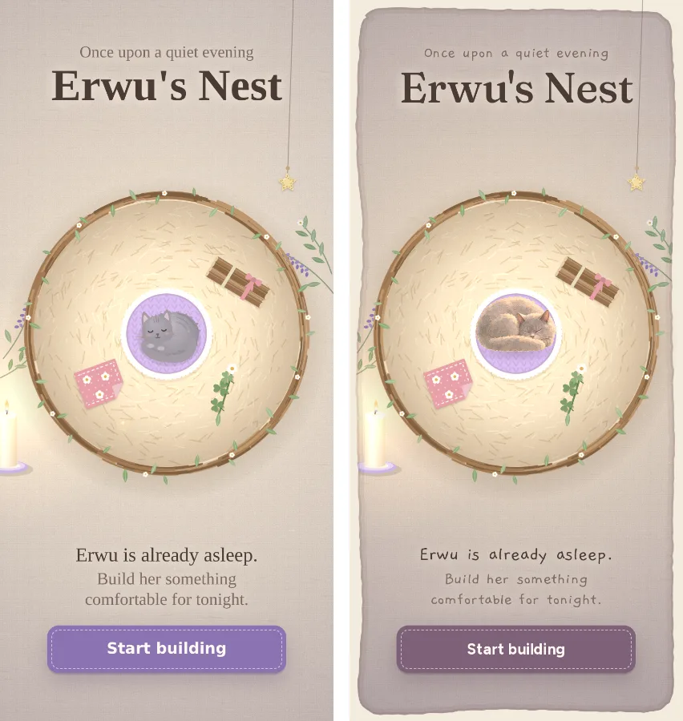
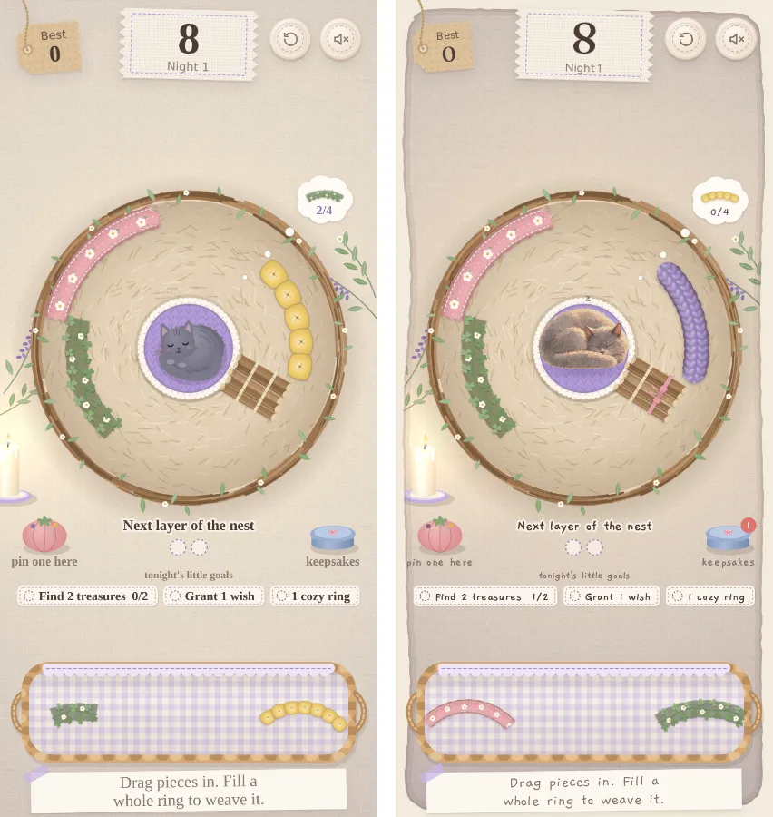

# Art direction: the same storybook, a different hour

Nest and Bloom are two pages of one storybook. **Bloom** is the afternoon, outdoors in Erwu's garden. **Nest** is that evening, indoors by lamplight. The two games should feel connected but distinct: the drawing and the cat are shared, while the light, the palette and the materials change.

Bloom's direction (the storybook sheets and the owner's target mockup) lives in the Bloom repo at `.scratch/art-direction/`. It is further along and is the reference for anything shared.

## Shared with Bloom (keep identical)

| | What | Where |
|---|---|---|
| Erwu | The same painted charcoal British Shorthair: round, full cheeks, small wide-set ears, heavy-lidded amber eyes, big fluffy tail. Never redrawn separately. | Bloom's `assets/erwu.webp`, copied by `tools/sync-erwu.cjs` |
| Drawing | Simplified storybook forms, soft warm-brown outlines, watercolour and gouache washes, subtle paper grain. Not photographic, not 3D, not vector. | The style block in Bloom's `PROMPTS.md`, reused word for word in Nest's prompts |
| The page | The cream paper both games are painted on (`#F3ECDD`), and the rounded, deckled edge with pigment pooled just inside it | `paintPaperEdge()` in `index.html` (ported from Bloom) |
| Display type | Fraunces, soft (`SOFT 100`), weight around 460–500, for titles and big numbers | `--serif` |

## Nest's own (keep distinct)

| | Bloom | Nest |
|---|---|---|
| Hour and place | Afternoon, outdoors in the garden | Evening, indoors, lamp-lit |
| Light | Sun from the upper left, airy | A warm pool from the candle, lower left; dusky plum corners that deepen as the night goes on; moonlight through the window later |
| Palette | Butter, sage, blush, cornflower | Oat, lamp amber, dusty rose, plum (`#7E6179`), twilight blue |
| Materials | Plants, stone, wood, parchment, a wooden sign | Fabric, wool, thread, felt, kraft paper, buttons, pinked edges |
| Erwu | Awake and wandering | Asleep in the nest: curled up; looks up from a loaf when a piece comes close; sits up content for a wish; a big stretch-yawn |
| Handwriting | None | Gaegu for story lines, hints and labels, like notes pinned to the fabric |

**What links them:** Nest's lavender, clover and twigs are from Bloom's garden. Nest's keepsake tin pairs with Bloom's seed tin. The painted backdrop (below) should show the garden at dusk through the window, with the fountain and log in soft silhouette.

## Built (2026-09-28)




- **Erwu is Bloom's cat.** `drawErwu` draws Bloom's poses: curl, loaf, sit-content and stretch. The poses crossfade over 0.35 s, share one scale, and sit on a soft contact shadow. Each pose is relit for the evening and cached per night level: saturation drops a little, the lamp side is warm and the far side dusky plum, deepening as the night falls. Breathing, bounce, the settling-in turn and the purr ripples carry over. The drawn cat is kept as a stand-in until the image loads, recoloured to her charcoal and amber (`erwu-curl-loaf.webp`).
- **Evening from the start.** The tablecloth has a plum wash, a warm lamp pool round the nest and dusky corners. The room's vignette starts darker. The existing nightfall (dimming, moonlit panes, the candle burning down, fireflies) builds on that.
- **The page edge:** Bloom's deckled paper edge, drawn over the room's light, so the night never reaches the margin. The candle moved in so the edge doesn't cut it.
- **Type:** Fraunces for the title, the score, the best score, the toast and the end card. Gaegu stays for the story lines, hints and goals; Figtree for the UI.
- **Palette:** the saturated lilac button (`#8B73B3`) is now dusk plum (`#7E6179`). The stitched accents follow.

## Waiting on sheets

These need generated art. Their prompts should reuse Bloom's style block exactly and attach Bloom's `target-mockup.webp` and `erwu-sprite-v2.png` as references. Bloom's `tools/build-art.cjs` is the pipeline to port for cutting and packing them.

1. **Room backdrop (9:16):** a lamp-lit linen tablecloth by a window, with the garden at dusk outside (fountain upper left, log upper right, soft silhouettes). The middle stays calm for the nest. This replaces `paintRoom()`'s drawn cloth, and the moonlit panes are then drawn from the painted window.
2. **Material swatches:** a flat, tileable painted swatch for each material (twig, clover, knit, quilt, puff, gingham, lavender). They are laid inside the existing piece shapes the way Bloom lays watercolour into its petals, so hit areas and ring geometry don't change.
3. **Nest pieces:** the straw floor, the twig-and-vine rim for each night's dressing, the lace doily and Erwu's knitted cushion.
4. **Props:** candle and saucer, pincushion, keepsake tin, the gingham tray basket, the kraft tag and the linen label.
5. **Erwu, extra sleeping poses (only if needed):** kneading, a paw over her face, a dream twitch. Generate these on Bloom's sheet layout, from Bloom's sheet, so she never drifts; they then reach Nest through `tools/sync-erwu.cjs`.

## Keeping Erwu in step

Bloom owns Erwu. After her art changes there, run the following from the Nest repo:

```sh
node tools/sync-erwu.cjs ../bloom   # or BLOOM_DIR=/path/to/bloom
```

This copies `assets/erwu.webp` and regenerates `erwu-art.js`; the header records the Bloom commit it came from. Nest uses the frames `curl`, `loaf`, `sit-content` and `stretch` (`poseFor()` in `index.html`). If Bloom renames any of them, update `poseFor()` too.
